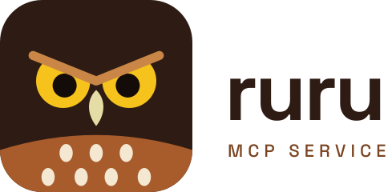
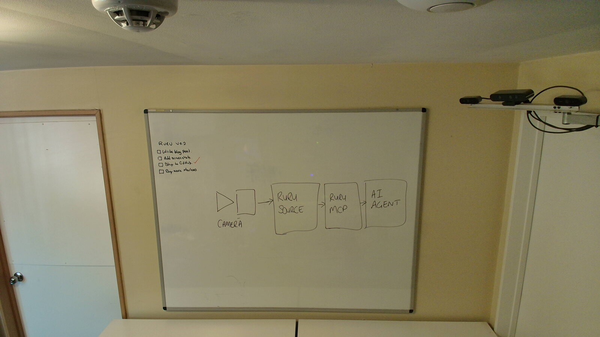
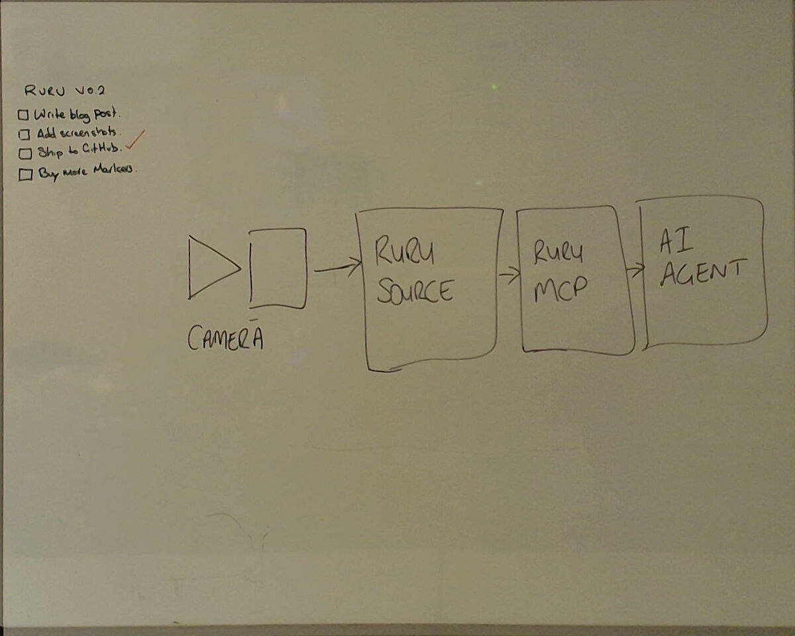
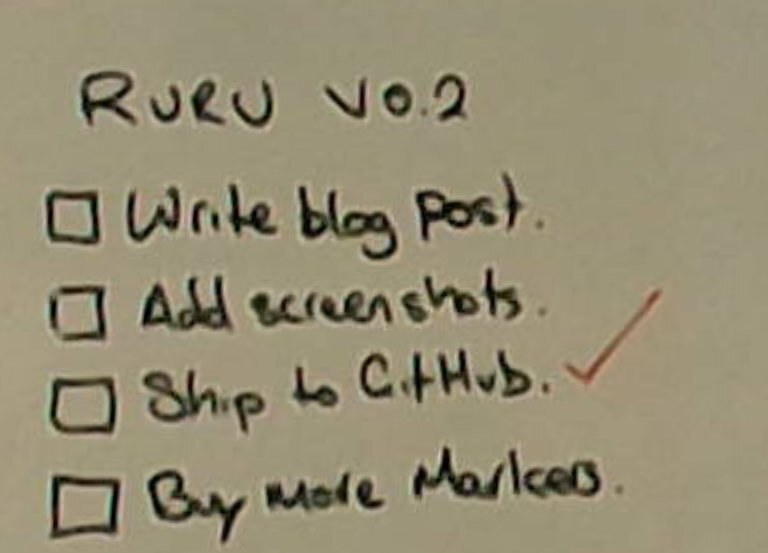
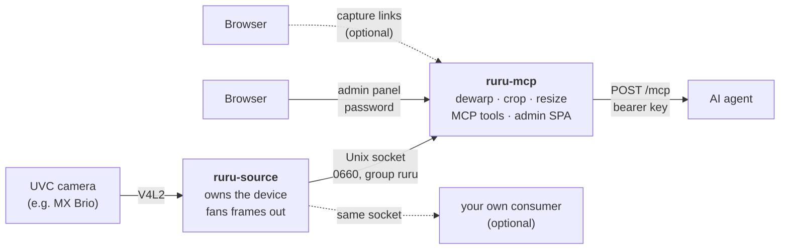
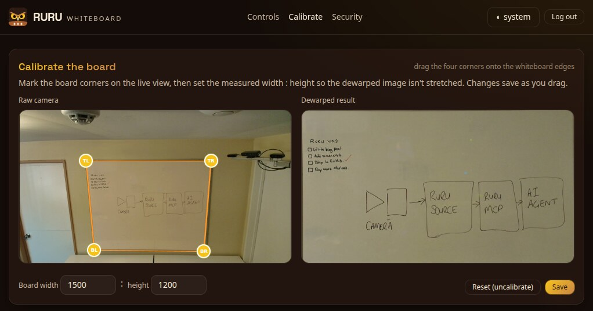
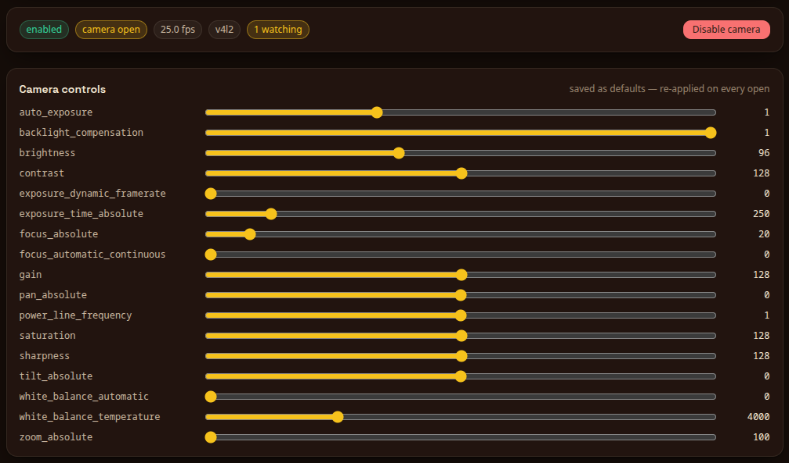

<picture>
  <source media="(prefers-color-scheme: dark)" srcset="docs/brand/ruru-lockup-dark.svg">
  
</picture>

# Ruru

**Let an AI agent read your office whiteboard.**

Ruru points a USB webcam at a whiteboard and serves it to AI agents over
[MCP](https://modelcontextprotocol.io). Ask your agent *"what's on the whiteboard?"* and it
calls `capture_whiteboard`. It gets back a clean, head-on image of the board, already
perspective-corrected from wherever the camera is mounted, and can read it, summarise it or
turn it into tickets. If some handwriting is too small, it can zoom into a region at full
4K resolution.

It's built for a trusted LAN: two small static Rust binaries, systemd units, and a web
admin panel for calibration and camera tuning. Nothing leaves your network.

> Named after the **ruru** (morepork), New Zealand's small native owl. It watches quietly
> and only when needed.

| What the camera sees | What the agent gets (`capture_whiteboard`) |
|---|---|
|  |  |

When handwriting is too small to read, `capture_region` pulls any part of the board at full
4K resolution:



## How it works



- **`ruru-source`** is the only process that opens the camera. A UVC device allows a single
  streaming owner, so this daemon owns it and fans frames out to any number of local
  consumers over a Unix socket. It knows nothing about whiteboards, so you can build other
  consumers (gesture detection, occupancy, anything) as peers.
- **`ruru-mcp`** is a client of the source. It dewarps the board using four calibrated
  corners, downscales it to a model-friendly size, and serves MCP tools plus an embedded
  Vue admin panel.
- The camera is only open **while something is looking**. It opens on the first request
  and idle-closes after the last one. An always-on camera in an office is a surveillance
  device, so that's the default, and every open and close is logged.

### MCP tools

| Tool | What it returns |
|---|---|
| `capture_whiteboard` | The board, dewarped head-on and downscaled to ≤1568 px. The normal read. |
| `capture_region` | A rectangle of the dewarped board (`x,y,w,h` as 0..1 fractions) at full resolution. |
| `capture_raw` | The untouched camera frame, for debugging framing and focus. |
| `list_capabilities` | Calibration state, board aspect, available modes, source status. |

The server also sends MCP `instructions` at initialise time, so agents know when to use which
tool with no extra prompt or skill file.

## Hardware

- **A UVC webcam.** Developed and tested on the **Logitech MX Brio** (4K MJPG). Any camera
  that works with V4L2 and outputs MJPG should work. You'll need its control names from
  `v4l2-ctl -L` to lock exposure, white balance and focus.
- **A Linux box** the camera plugs into directly, on a USB 3 port. Bare metal works best:
  UVC video is isochronous USB, which emulated USB controllers in VMs handle poorly. x86_64
  is the tested target. aarch64 (e.g. a Raspberry Pi 5) should work but is untested.
- **A mount** with a clear view of the board. An off-angle view is fine, because the dewarp
  corrects it.

## Quickstart (no hardware needed)

The mock camera emits real MJPEG with the frame number burned into the image, so the whole
stack runs on a laptop.

Prerequisites: Rust ≥ 1.88 and Node ≥ 22.12.

```sh
make web-install && make web-build     # build the admin SPA (embedded into ruru-mcp)

# one-time: provision secrets: an admin password on stdin, and a bearer key (printed once)
echo 'change-me-please' | cargo run -p ruru-mcp -- --config config/mcp-dev.toml set-password
cargo run -p ruru-mcp -- --config config/mcp-dev.toml mint-key

make run      # terminal 1: ruru-source with the mock camera
make mcp      # terminal 2: ruru-mcp on http://127.0.0.1:8080
```

Open <http://127.0.0.1:8080/> and sign in. Then point an agent at it:

```sh
claude mcp add --transport http ruru http://127.0.0.1:8080/mcp \
  --header "Authorization: Bearer ruru_XXXX"
```

Configs for other MCP clients, plus raw `curl` examples, are in the
[`ruru-mcp` README](crates/ruru-mcp/README.md).

## Production install

```sh
make release                  # static musl binaries, SPA embedded
sudo bash deploy/install.sh   # users, configs, systemd units
```

Then set your camera's `/dev/v4l/by-id/…` path in `/etc/ruru/source.toml`, provision
secrets, and calibrate the board in the admin panel.



The admin panel also lets you tune and lock the camera's controls (exposure, white balance,
focus), which are re-applied every time the camera opens:

 The full sequence (and uninstall) is in
the **[deploy runbook](docs/deploy-runbook.md)**.

## Security model

Ruru is designed for a **trusted LAN behind a firewall**. Don't expose it to the internet.

| Surface | Protection |
|---|---|
| Source socket | Filesystem permissions: `0660`, group `ruru`. If the group can't be applied, the daemon refuses to start. |
| `POST /mcp` | 256-bit bearer key, stored only as a SHA-256 hash, compared in constant time. |
| Admin panel | argon2id password; encrypted session cookie that expires (12 h by default) and is revoked by any password change; per-IP lockout after repeated failed logins. |
| Capture links (optional, off by default) | **Unauthenticated** by design: `/captures/<id>.jpg` with a 128-bit random id, so a link opens in any browser. The link *is* the secret. Pruned by age and count. |

The services run as two separate non-root users under hardened systemd units. Only
`ruru-source` can open the camera, and `ruru-mcp` only ever sees frames through the socket.
Plain HTTP means the bearer key and admin password cross your LAN in cleartext. Firewall the
port, and see the runbook for an optional TLS reverse proxy.

To report a vulnerability, see [SECURITY.md](SECURITY.md).

## Design constraints

These are load-bearing and enforced in code:

- **Cameras are resolved by `/dev/v4l/by-id/…`, never `/dev/video0`.** UVC cameras expose
  several video nodes and renumber them on replug. Config validation rejects anything else.
- **One owner, always.** A single OS thread holds the device. A capture failure closes the
  handle, backs off, and reopens from scratch. That's also the replug path.
- **Locked optics.** Exposure, white balance and focus are pinned and re-applied on every
  open, in gate-before-gated order, so two captures of the same board are comparable.
- **Latest-frame-wins backpressure.** A slow subscriber is skipped forward to the newest
  frame, so it never stalls capture for everyone else.
- **Frames pass through untouched.** The source never decodes MJPG. Consumers decode only if
  they need pixels.

## The socket protocol

If you want to write your own consumer, use the `ruru-client` crate (`snapshot()` /
`subscribe()`). On the wire, every message is a `u32` big-endian length prefix (capped at
32 MiB), then a body whose first byte is a tag:

```
0x01  JSON control message
0x02  frame: 28-byte header, then payload
      seq u64 | timestamp_us u64 | width u16 | height u16 | fourcc [u8;4] | len u32
```

There's one request per connection. `snapshot` sends exactly one frame and closes.
`subscribe` streams until the client goes away or the source is disabled. A deliberate
shutdown sends a terminal JSON error, so a consumer can tell "turned off" from "gone slow".
The ops are `snapshot`, `subscribe`, `list_controls`, `get_control`, `set_control`, `status`
and `enable`. [`examples/ruru-tap`](examples/ruru-tap) is a minimal subscriber.

## Repository layout

| Path | What |
|---|---|
| `crates/ruru-source` | The camera daemon ([README](crates/ruru-source/README.md)). |
| `crates/ruru-client` | Socket protocol and typed client library. |
| `crates/ruru-mcp` | MCP server, image pipeline, admin API ([README](crates/ruru-mcp/README.md)). |
| `examples/ruru-tap` | Example subscriber that logs frame stats. |
| `web/` | Admin panel (Vite + Vue 3 + Tailwind), embedded into `ruru-mcp` at build time. |
| `config/` | Dev configs for the mock camera. |
| `deploy/` | systemd units, production configs, install/uninstall scripts. |
| `docs/` | The deploy runbook, README images, and brand assets (see [TRADEMARKS.md](TRADEMARKS.md)). |

## Contributing

Issues and PRs are welcome. See [CONTRIBUTING.md](CONTRIBUTING.md) for the dev loop.
`make check` runs everything CI runs.

## License

Licensed under either of [Apache License, Version 2.0](LICENSE-APACHE) or
[MIT license](LICENSE-MIT) at your option.

Unless you explicitly state otherwise, any contribution intentionally submitted for inclusion
in this project by you, as defined in the Apache-2.0 license, shall be dual licensed as
above, without any additional terms or conditions.

The Ruru name and owl logo are trademarks of Kultivator Consulting Ltd and are **not** covered
by either licence. Forks must use a different name and logo. See [TRADEMARKS.md](TRADEMARKS.md).

Built by [Kultivator Consulting](https://kultivator.co.nz) in Aotearoa New Zealand.
